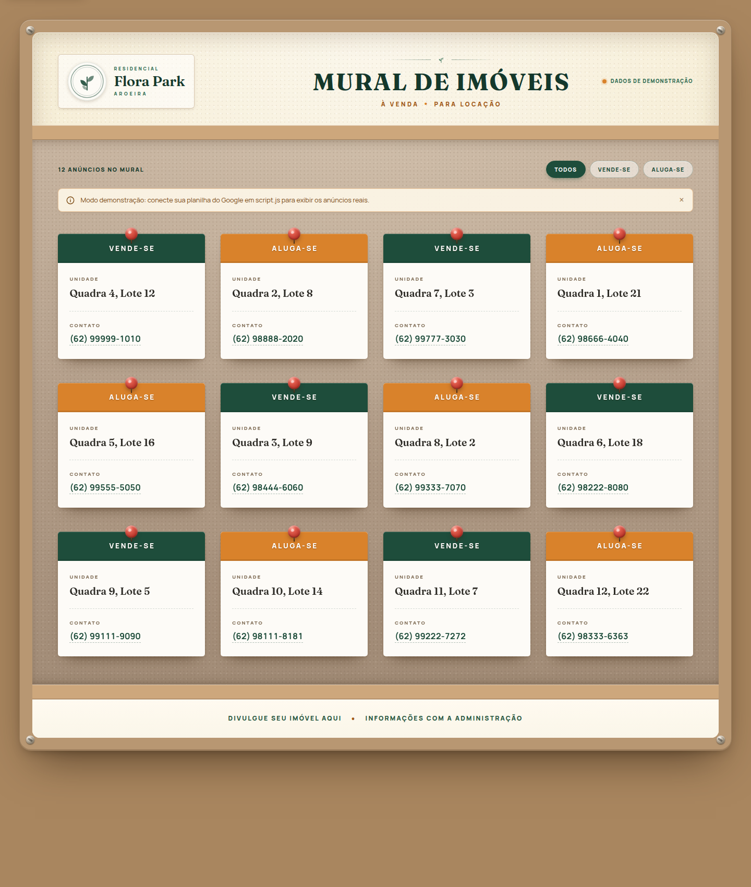

# Mural de Imóveis — Residencial Flora Park Aroeira

Mural digital de imóveis à venda e para locação do **Residencial Flora Park
Aroeira**. A página reproduz a estética de um mural de cortiça com moldura de
madeira e carrega os anúncios em tempo real de uma planilha pública do Google
Sheets.

Site 100% estático, sem backend, sem dependências e sem etapa de build: basta
HTML, CSS e JavaScript.



---

## Sumário

- [Sobre o projeto](#sobre-o-projeto)
- [Funcionalidades](#funcionalidades)
- [Tecnologias](#tecnologias)
- [Estrutura do projeto](#estrutura-do-projeto)
- [Como rodar localmente](#como-rodar-localmente)
- [Modo demonstração](#modo-demonstração)
- [Conectar a planilha do Google](#conectar-a-planilha-do-google)
- [Configurações do site](#configurações-do-site)
- [Como o código funciona](#como-o-código-funciona)
- [Personalização](#personalização)
- [Publicar no GitHub Pages](#publicar-no-github-pages)
- [Acessibilidade e responsividade](#acessibilidade-e-responsividade)
- [Solução de problemas](#solução-de-problemas)
- [Licença](#licença)

---

## Sobre o projeto

O mural exibe cada anúncio como uma ficha fixada com tachinha. Os cards são
separados por tipo:

- **VENDE-SE** — cabeçalho verde (`#1e4d3b`).
- **ALUGA-SE** — cabeçalho terracota (`#d9822b`).

O conteúdo vem de uma planilha com as colunas `status`, `unidade` e `contato`.
Sempre que a planilha é atualizada, o site reflete as mudanças na próxima
atualização automática (a cada 5 minutos por padrão) ou ao recarregar a página.

## Funcionalidades

- Layout responsivo com 4, 3, 2 ou 1 coluna conforme a largura da tela.
- Cards com tachinha, cantos retos, sombra e elevação no hover.
- Filtros **Todos / Vende-se / Aluga-se** com contador de resultados.
- Integração com Google Sheets via CSV público.
- Conversão automática de link de edição ou `pubhtml` para o endpoint CSV.
- Parser CSV próprio: aceita vírgula, ponto e vírgula ou tabulação, campos
  entre aspas, quebras de linha, BOM e CRLF.
- Telefones viram links de WhatsApp com mensagem pré-preenchida; e-mails viram
  links `mailto:`.
- Atualização automática periódica, com opção de desativar.
- Estados de carregamento (skeleton), erro com botão de tentar novamente e
  modo demonstração.
- Se uma atualização falhar, os anúncios já exibidos são preservados.
- Acessibilidade: link de atalho, navegação por teclado, `aria-live`,
  `aria-pressed`, foco visível e respeito a `prefers-reduced-motion`.
- Estilos de impressão para gerar uma versão em papel do mural.
- Nenhuma dependência de JavaScript, nenhum framework e nenhum build.

## Tecnologias

| Camada | Tecnologia |
| --- | --- |
| Estrutura | HTML5 semântico |
| Estilo | CSS3 (Grid, Flexbox, custom properties, media queries) |
| Comportamento | JavaScript moderno (Vanilla JS, `fetch`, `AbortController`) |
| Tipografia | Google Fonts — Fraunces e Manrope |
| Dados | Google Sheets publicado como CSV |

## Estrutura do projeto

```text
.
├── index.html            Estrutura e conteúdo estático da página
├── style.css             Design system, layout, animações e responsividade
├── script.js             CONFIG, parser CSV, fetch, renderização e filtros
├── planilha-exemplo.csv  Modelo de planilha para importar no Google Sheets
├── preview.png           Captura usada na prévia deste README
└── README.md             Esta documentação
```

> A imagem `Mural_Imoveis_Flora_Park_Aroeira_Editavel.png`, usada como
> referência visual durante o desenvolvimento, está listada no `.gitignore` e
> não é enviada ao repositório. Para versioná-la, remova a linha
> correspondente do `.gitignore`.

## Como rodar localmente

Não há instalação de dependências. Abra o `index.html` no navegador ou, para
evitar restrições de CORS em alguns navegadores, sirva a pasta por HTTP:

```bash
# na raiz do projeto
python3 -m http.server 8000

# acesse http://localhost:8000
```

Também funciona com qualquer servidor estático (Live Server do VS Code,
`npx serve`, Nginx, Apache etc.).

## Modo demonstração

Enquanto `CONFIG.csvUrl` e `CONFIG.sheetId` estiverem vazios, o site exibe
**12 anúncios de demonstração** (6 VENDE-SE e 6 ALUGA-SE) e um aviso indicando
o modo de exemplo. Assim é possível apresentar o layout antes de conectar a
planilha real.

O comportamento é controlado em `script.js`:

```js
const CONFIG = {
  csvUrl: '',
  sheetId: '',
  demoFallback: true, // false = mostra tela de erro quando não há planilha
  // ...
};
```

- `demoFallback: true` — usa os dados de `DEMO_ITEMS` se não houver planilha
  configurada ou se a planilha falhar.
- `demoFallback: false` — mostra a tela de erro com botão **Tentar novamente**.

Ao configurar uma planilha válida, o modo demonstração sai automaticamente
assim que os dados reais são carregados.

## Conectar a planilha do Google

### 1. Monte a planilha

Na primeira linha da aba, use os cabeçalhos:

| status | unidade | contato |
| --- | --- | --- |
| VENDE-SE | Quadra 4, Lote 12 | (62) 99999-1010 |
| ALUGA-SE | Quadra 2, Lote 8 | (62) 98888-2020 |

Regras de preenchimento:

- **`status`**: aceita variações como `VENDE-SE`, `VENDA`, `VENDER`, `ALUGA-SE`,
  `ALUGUEL`, `LOCAÇÃO` e `LOCAR`. Status não reconhecidos aparecem em cinza com
  o texto original.
- **`unidade`**: texto livre (ex.: `Quadra 4, Lote 12`). Também é possível usar
  colunas separadas `quadra` e `lote`.
- **`contato`**: telefone/WhatsApp ou e-mail. Telefones com 10 a 13 dígitos
  ganham link automático para o WhatsApp; e-mails viram `mailto:`.
- Linhas sem `unidade` são ignoradas.
- Colunas extras são ignoradas.

O arquivo [`planilha-exemplo.csv`](planilha-exemplo.csv) pode ser importado
diretamente no Google Sheets para começar.

#### Cabeçalhos alternativos aceitos

| Campo | Nomes aceitos |
| --- | --- |
| Status | `status`, `situacao`, `tipo`, `categoria`, `anuncio` |
| Unidade | `unidade`, `imovel`, `localizacao`, `endereco`, `quadra_lote`, `quadra_e_lote`, `loteamento` |
| Contato | `contato`, `telefone`, `celular`, `whatsapp`, `fone`, `tel`, `email`, `e_mail` |
| Quadra | `quadra`, `qd` |
| Lote | `lote`, `lt` |

A comparação ignora acentos, espaços e maiúsculas/minúsculas.

### 2. Publique a planilha

1. No Google Sheets, abra **Arquivo → Compartilhar → Publicar na web**.
2. Escolha a aba correta e o formato **CSV**.
3. Copie o link gerado.

> A planilha precisa estar acessível publicamente. Não é necessário dar
> permissão de edição a ninguém.

### 3. Configure o site

Abra `script.js` e preencha **uma** das opções:

```js
const CONFIG = {
  // Opção A — link CSV publicado
  csvUrl: 'https://docs.google.com/spreadsheets/d/e/2PACX.../pub?output=csv',

  // Opção B — ID da planilha + aba
  sheetId: '1AbC...',
  sheetName: '', // vazio = primeira aba; ou informe 'Mural'
  sheetGid: '',  // opcional, usado quando o link tem #gid=
  // ...
};
```

Formatos de link aceitos em `csvUrl`:

| Link informado | Conversão automática |
| --- | --- |
| `.../spreadsheets/d/ID/edit#gid=0` | `.../spreadsheets/d/ID/export?format=csv&gid=0` |
| `.../spreadsheets/d/e/.../pubhtml` | `.../spreadsheets/d/e/.../pub?output=csv` |
| `.../spreadsheets/d/e/.../pub?output=csv` | Mantido como está |

### 4. Atualize os anúncios

Depois de configurar, basta editar a planilha. O site busca os dados novamente:

- ao abrir/recarregar a página;
- a cada `refreshMinutes` minutos (padrão: 5);
- ao clicar em **Tentar novamente**, em caso de erro.

## Configurações do site

Todas as opções ficam no objeto `CONFIG`, no início de `script.js`:

| Opção | Padrão | Descrição |
| --- | --- | --- |
| `csvUrl` | `''` | Link CSV publicado ou link de edição da planilha. |
| `sheetId` | `''` | ID da planilha (alternativa ao `csvUrl`). |
| `sheetName` | `''` | Nome da aba. Vazio = primeira aba. |
| `sheetGid` | `''` | `gid` da aba, quando necessário. |
| `demoFallback` | `true` | Exibe dados de exemplo se a planilha não estiver disponível. |
| `refreshMinutes` | `5` | Intervalo de atualização automática. `0` desativa. |
| `timeoutMs` | `12000` | Tempo máximo de espera pela planilha, em milissegundos. |

## Como o código funciona

Fluxo de execução em `script.js`:

1. `init()` verifica se há planilha configurada e inicia a carga dos dados.
2. `resolveSheetUrl()` normaliza o link informado e gera a URL CSV correta.
3. `fetchSheet()` busca o CSV com `fetch`, `cache: 'no-store'` e timeout via
   `AbortController`.
4. `parseCSV()` detecta o separador (vírgula, ponto e vírgula ou tabulação) e
   trata campos entre aspas, quebras de linha, BOM e CRLF.
5. `rowsToItems()` mapeia os cabeçalhos (incluindo aliases), ignora linhas sem
   unidade e classifica cada anúncio como `vende-se`, `aluga-se` ou `outro`.
6. `renderItems()` e `createCard()` montam os cards no DOM.
7. `applyFilter()` e `updateCount()` aplicam o filtro ativo e atualizam o
   contador.
8. `scheduleAutoRefresh()` agenda as próximas atualizações.

| Função | Responsabilidade |
| --- | --- |
| `loadData()` | Orquestra busca, tratamento de erro e renderização. |
| `fetchSheet()` | Requisição HTTP com timeout. |
| `resolveSheetUrl()` | Converte links do Google Sheets em URL CSV. |
| `parseCSV()` | Parser CSV sem dependências. |
| `rowsToItems()` | Transforma linhas em objetos de anúncio. |
| `renderItems()` | Renderiza os cards e aplica o filtro ativo. |
| `applyFilter()` | Mostra apenas os anúncios do tipo selecionado. |
| `contactLink()` | Gera links de WhatsApp ou `mailto:`. |
| `useDemo()` | Ativa o modo demonstração. |
| `scheduleAutoRefresh()` | Configura a atualização periódica. |

## Personalização

### Cores

As cores ficam em `:root`, no início de `style.css`:

| Variável | Valor | Uso |
| --- | --- | --- |
| `--green-800` | `#1e4d3b` | Cabeçalho VENDE-SE e textos verdes |
| `--terracotta` | `#d9822b` | Cabeçalho ALUGA-SE |
| `--terracotta-dark` | `#9f5612` | Subtítulo e filtros |
| `--cream` | `#fdfbf7` | Corpo dos cards |
| `--board` | `#f4ebd0` | Painel claro do cabeçalho |
| `--cork` | `#b7a28f` | Painel de cortiça atrás dos cards |
| `--wood` | `#b89772` | Moldura e faixas de madeira |
| `--footer-bg` | `#faf6e9` | Barra do rodapé |
| `--footer-ink` | `#24543c` | Texto do rodapé |

Para um painel de fundo mais claro, troque `--cork` e `--cork-light` por
`#f4ebd0` e `#f7efd8`. O restante do layout continua igual.

### Logotipo

O logotipo atual é um SVG dentro de `.brand__mark`, em `index.html`. Para usar
uma imagem, substitua o SVG por:

```html

```

### Textos

- Título e subtítulo: `.title` e `.subtitle` em `index.html`.
- Rodapé: `.board__footer` em `index.html`.
- Mensagem de demonstração e textos de erro: `script.js`.
- Dados de exemplo: array `DEMO_ITEMS` em `script.js`.

### Tipografia

As fontes Fraunces (títulos) e Manrope (textos) são carregadas pelo Google
Fonts no `<head>` de `index.html`. Para usar fontes locais ou outras famílias,
altere `--font-display` e `--font-sans` em `style.css`.

## Publicar no GitHub Pages

O projeto é estático e funciona diretamente no GitHub Pages.

1. Envie os arquivos para o repositório:

   ```bash
   git add .
   git commit -m "Documenta o projeto"
   git push origin main
   ```

2. No GitHub, abra **Settings → Pages**.
3. Em **Build and deployment**, selecione **Deploy from a branch**.
4. Escolha a branch `main` e a pasta `/ (root)`.
5. Clique em **Save** e aguarde a publicação (geralmente 1 a 2 minutos).

O site ficará disponível em:

```text
https://augusto-cesar-dsr.github.io/aroeira/
```

> O GitHub Pages serve arquivos por HTTPS e sem backend. A planilha continua
> sendo lida diretamente do Google Sheets, então ela precisa permanecer
> pública. Nenhuma variável de ambiente ou segredo é necessária.

### Checklist antes de publicar

- [ ] `CONFIG.csvUrl` ou `CONFIG.sheetId` preenchido em `script.js`.
- [ ] Planilha publicada como CSV e acessível publicamente.
- [ ] Cabeçalhos `status`, `unidade` e `contato` presentes.
- [ ] Pelo menos um anúncio com `unidade` preenchida.
- [ ] Teste local em `http://localhost:8000` antes do push.
- [ ] Confira o site publicado em desktop e celular.

## Acessibilidade e responsividade

- Link **Ir para os anúncios** para pular a navegação.
- Status de carregamento, contagem e avisos anunciados com `aria-live`.
- Filtros com `aria-pressed` e `aria-controls`.
- Foco visível para navegação por teclado.
- Contraste adequado nos textos e botões.
- Animações reduzidas quando o sistema usa `prefers-reduced-motion`.
- Mensagem de fallback em `<noscript>`.
- Grid fluido: 4 colunas em telas largas, 3 em médias, 2 em tablets e 1 em
  celulares (abaixo de 480 px).
- Testado de 360 px a 1440 px sem rolagem horizontal.

## Solução de problemas

| Problema | Causa provável / solução |
| --- | --- |
| Aparece o aviso de demonstração | `CONFIG.csvUrl` e `CONFIG.sheetId` estão vazios, ou a planilha não está pública. |
| “Retornou HTML em vez de CSV” | Use **Publicar na web → CSV**, não o link de edição. |
| Nenhum anúncio válido | Confira os cabeçalhos e se a coluna `unidade` está preenchida. |
| Erro de CORS ou de rede | Publique a planilha como CSV e sirva o site por HTTP/HTTPS. |
| Números sem link | O contato precisa ter de 10 a 13 dígitos (DDD + número). |
| E-mail sem link | Verifique se o contato tem formato de e-mail válido. |
| Alterações não aparecem | Aguarde a atualização automática ou recarregue a página. |
| Página em branco no GitHub Pages | Confirme que `index.html` está na raiz e que o Pages está configurado em `main` / root. |
| Fonte diferente do esperado | O Google Fonts pode estar bloqueado; o CSS possui fontes de fallback. |

Os erros detalhados também aparecem no console do navegador com o prefixo
`[Mural de Imóveis]`.

## Licença

Este projeto foi desenvolvido para o **Residencial Flora Park Aroeira**. O
código pode ser adaptado para outros condomínios; o nome, a identidade visual e
o conteúdo dos anúncios pertencem aos seus respectivos responsáveis.

---

Dúvidas, correções ou sugestões: abra uma issue no repositório ou fale com a
administração do condomínio.
